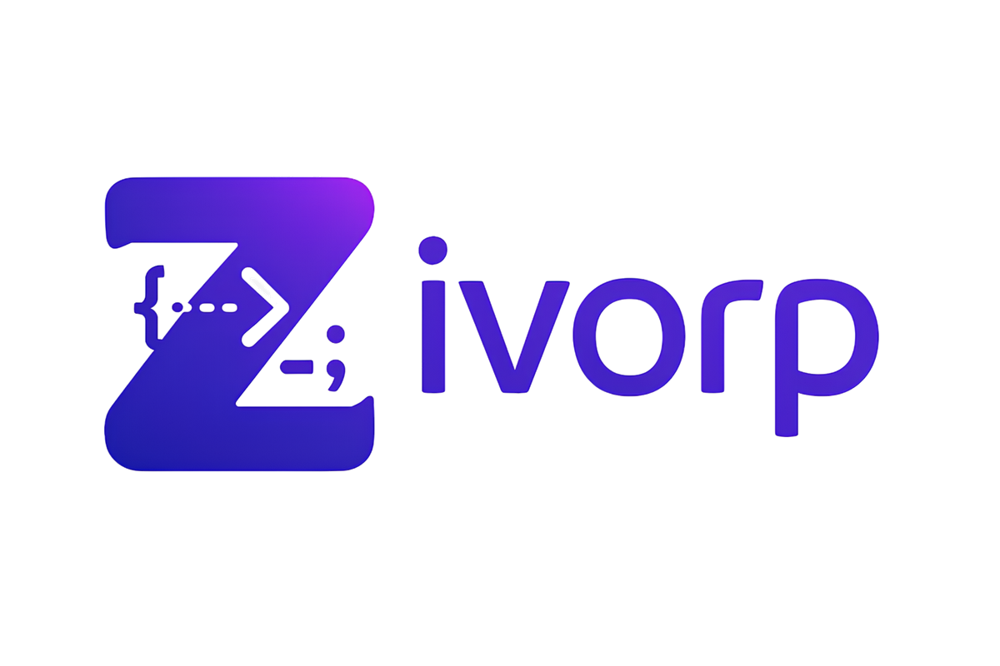
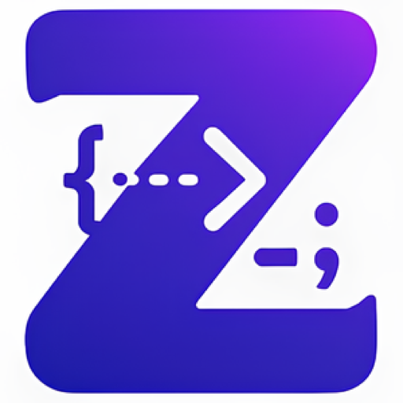

<p align="center">
  
</p>

<h1 align="center">Zivorp · Debug Visual</h1>

<p align="center">
  <b>코드를 시각적으로 이해하는 새로운 방법</b><br />
  작성한 코드를 실제로 실행하고, 실행 흐름을 애니메이션으로 시각화하며, 실시간으로 함께 코딩합니다.
</p>

<p align="center">
  <a href="https://zivorp.kro.kr"></a>
  <a href="https://youtu.be/e7gYvL_8_JQ"></a>
  <a href="https://youtu.be/xKBZ3hl2ebo"></a>
  <a href="https://www.dbpia.co.kr/journal/articleDetail?nodeId=NODE12551263"></a>
</p>

---

## Overview

프로그래밍 입문자가 가장 어려워하는 것은 문법이 아니라 **코드가 실행되는 동안 내부에서 무슨 일이 벌어지는지 상상하는 일**입니다.

배열의 값이 언제 교환되는지, 재귀 호출이 어디까지 내려갔다 돌아오는지, 스택에서 무엇이 빠져나가는지는 코드만 봐서는 잘 보이지 않습니다. 기존 학습 도구는 미리 만들어 둔 예제만 보여주기 때문에, 정작 **내가 쓴 코드**의 흐름은 확인할 수 없습니다.

Zivorp는 사용자가 직접 작성한 코드를 실제 컨테이너에서 실행하고, 그 실행 흐름을 이벤트 단위로 해석해 애니메이션으로 재생합니다.

```text
코드 작성 → 격리 컨테이너 실행 → 실행 흐름 분석(DV-Flow JSON) → 자료구조 애니메이션 → 협업 · 공유
```

---

## Demo

<p align="center">
  <a href="https://youtu.be/e7gYvL_8_JQ">
    
  </a>
</p>

- 시연영상: https://youtu.be/e7gYvL_8_JQ
- 발표영상: https://youtu.be/xKBZ3hl2ebo
- 배포 주소: https://zivorp.kro.kr
- 이전 주소: https://zivorp.com *(도메인 만료, 백엔드 미동작)*

---

## Core Features

### 1. 시각화 IDE

Monaco Editor 기반 웹 IDE에서 C · Python · Java 코드를 작성하고 입력값과 함께 바로 실행합니다. 실행 결과(stdout/stderr)와 시각화를 한 화면에서 확인할 수 있습니다.

### 2. 실행 흐름 시각화

실행 흐름을 자료구조 · 알고리즘 유형별 애니메이션으로 재생합니다. 코드를 분석해 어떤 시각화가 적합한지 자동으로 판별합니다.

| 분류 | 시각화 |
| --- | --- |
| 정렬 | 버블 정렬, 선택 정렬, 삽입 정렬 |
| 선형 자료구조 | 스택, 큐, 연결 리스트 |
| 비선형 자료구조 | 이진 트리, 힙, 그래프 |
| 제어 흐름 | 재귀 호출 (팩토리얼, 피보나치) |

### 3. DV-Flow — 실행 흐름 표현 스키마

시각화의 핵심은 실행 흐름을 정규화된 JSON으로 표현하는 **DV-Flow** 스키마입니다. LLM이 코드를 해석해 아래 형태의 이벤트 시퀀스를 생성하고, 프론트엔드는 이 JSON만으로 애니메이션을 렌더링합니다.

```jsonc
{
  "lang": "python",
  "input": "5 3 8 1",
  "analysis": {
    "timeComplexity": "O(n^2)",
    "spaceComplexity": "O(1)"
  },
  "events": [
    { "t": 1, "kind": "compare", "expr": "a[0] > a[1]", "result": true },
    { "t": 2, "kind": "swap", "target": "a", "indices": [0, 1],
      "before": [5, 3], "after": [3, 5] },
    { "t": 3, "kind": "loopIter", "loop": { "type": "for", "iter": 1 } }
  ]
}
```

`compare` · `assign` · `swap` · `call` · `return` · `loopIter` · `branch` · `ds_op` · `io` · `exception` 등 11종의 이벤트로 실행 과정을 기술하며, 시간·공간 복잡도 분석 결과도 함께 제공합니다. 시각화 로직이 특정 언어에 묶이지 않도록 **실행기와 렌더러를 이 스키마로 분리**한 것이 구조상 핵심이며, 이 설계는 [학술대회 논문](#publication)으로 발표했습니다.

### 4. Codecast — 실시간 코드 방송

WebSocket(STOMP) 기반으로 여러 명이 같은 코드를 동시에 편집하고, 코드 작성 과정을 실시간으로 공유합니다.

- 방(Room) · 세션 생성과 참가자 관리
- 편집 권한 부여 및 회수
- 실시간 채팅과 코드 미리보기 목록
- 저장된 코드 파일 불러오기 및 공유

### 5. 커뮤니티 & 마이페이지

- 게시글 · 댓글 · 좋아요 · 태그 · 신고 · 알림
- 내 프로젝트, 공유받은 파일, 알림, 계정 설정 관리
- JWT 기반 회원가입 · 로그인, 관리자 기능

---

## Architecture

```text
                    ┌──────────────────────────────┐
                    │   Frontend (React 19 · CRA)  │
                    │  Monaco Editor · D3.js 시각화 │
                    └───────┬──────────────┬───────┘
                 REST/JWT   │              │  WebSocket (STOMP · SockJS)
                            ▼              ▼
                    ┌──────────────────────────────┐
                    │   Backend (Spring Boot 3.4)  │
                    │  Auth · Community · Collab   │
                    │  File(S3) · Admin · Swagger  │
                    └───────┬──────────────┬───────┘
                            │              │
                            ▼              ▼
              ┌──────────────────────┐  ┌─────────┐
              │  Spike (Flask)       │  │  MySQL  │
              │  코드 실행 · 흐름 분석 │  └─────────┘
              └──────────┬───────────┘
                         │  docker run --rm (요청별 격리 디렉터리)
                         ▼
              ┌──────────────────────────────────┐
              │  실행 컨테이너   C · Python · Java  │
              └──────────────────────────────────┘
```

코드 실행은 요청마다 고유 작업 디렉터리를 만들어 언어별 Docker 이미지에서 처리하고, 실행 후 즉시 정리합니다. 실행 시간 초과(10초)에는 타임아웃 응답을 반환합니다.

---

## Repository

| Repository | Stack | Description |
| --- | --- | --- |
| [DebugVisual_FrontEnd](https://github.com/DMU-DebugVisual/DebugVisual_FrontEnd) | React | 웹 클라이언트. 시각화 IDE, D3 애니메이션, Codecast, 커뮤니티, 마이페이지 |
| [DebugVisual_BackEnd](https://github.com/DMU-DebugVisual/DebugVisual_BackEnd) | Spring Boot | API 서버. 인증, 커뮤니티, 협업 세션, 파일 업로드, 관리자 |
| [DebugVisual_Spike](https://github.com/DMU-DebugVisual/DebugVisual_Spike) | Flask | 코드 실행 서버. 언어별 Docker 샌드박스 실행, DV-Flow 흐름 분석 |
| [.github](https://github.com/DMU-DebugVisual/.github) | — | Organization Profile |

---

## Tech Stack

| Layer | Stack |
| --- | --- |
| Frontend | React 19, React Router 7, Monaco Editor, D3.js, Axios, SockJS · STOMP |
| Backend | Spring Boot 3.4, Java 17, Spring Security, JPA, WebSocket, WebFlux |
| Execution | Flask, Docker (C · Python · Java 이미지), OpenAI API |
| Database | MySQL |
| Storage | AWS S3 |
| Auth | JWT (jjwt) |
| API Docs | springdoc-openapi (Swagger UI) |
| Infra | AWS EC2, Nginx, Docker Compose, GitHub Actions |
| Collaboration | Notion, Figma, GitHub |

---

## Publication

프로젝트의 핵심 설계인 DV-Flow 스키마와 웹 기반 재생 파이프라인을 학술대회 논문으로 발표했습니다.

> ### 언어 비의존 코드 실행 시각화를 위한 최소 이벤트 스키마와 웹 기반 재생 파이프라인
>
> *DV-Flow: A Minimal Event Schema and Web-Based Replay Pipeline for Language-Agnostic Program Execution Visualization*
>
> 김인성, 한민정, 채선웅, 윤동준, 박소정, 황선희 — 동양미래대학교<br />
> **2025년 대한전자공학회 추계학술대회 논문집**, pp. 1336–1339
>
> 4개의 최상위 키와 11종의 이벤트 타입만으로 프로그램 실행 흐름을 표현하는 최소 스키마를 정의하고,
> 이를 웹에서 재생하는 파이프라인을 구현해 다중 언어 코드 시각화를 언어 비의존적으로 처리하는 방법을 제안합니다.
>
> [DBpia에서 논문 보기](https://www.dbpia.co.kr/journal/articleDetail?nodeId=NODE12551263)

---

## Team

| Name | GitHub | Focus |
| --- | --- | --- |
| 김인성 | [@Danto7632](https://github.com/Danto7632) | 프로젝트 총괄, 프론트엔드, 시각화 IDE |
| 한민정 | [@1anminJ](https://github.com/1anminJ) | 백엔드, 코드 실행 서버 |
| 채선웅 | [@chaesunwoong](https://github.com/chaesunwoong) | 프론트엔드 |
| 박소정 | [@sojeongP0415](https://github.com/sojeongP0415) | 프론트엔드 |
| 윤동준 | [@yoon1017](https://github.com/yoon1017) | 프론트엔드 |

---

## Documents

| Document | Link |
| --- | --- |
| PRD | [제품 요구사항 정의서](https://respected-jitterbug-a9b.notion.site/PRD-1c2dd1e1f08280e9bf94f9c9b1dfb29f) |
| 결과보고서 | [프로젝트 결과보고서](https://respected-jitterbug-a9b.notion.site/208dd1e1f0828025b739ff4bd834d243?source=copy_link) |
| 협업 규칙 | [Commit · Issue · PR 작성 가이드](https://respected-jitterbug-a9b.notion.site/Commit-Issue-PR-1bcdd1e1f08280db8de2c766a5892210?pvs=4) |
| 팀 역량 분석 | [Canva 자료](https://www.canva.com/design/DAGhfXaBYoI/ybEVHuPnt5kdrnyupHeazg/edit?utm_content=DAGhfXaBYoI&utm_campaign=designshare&utm_medium=link2&utm_source=sharebutton) |

<br />

<p align="center">
  <br />
  <sub><b>DMU-DebugVisual</b> · 동양미래대학교</sub>
</p>
